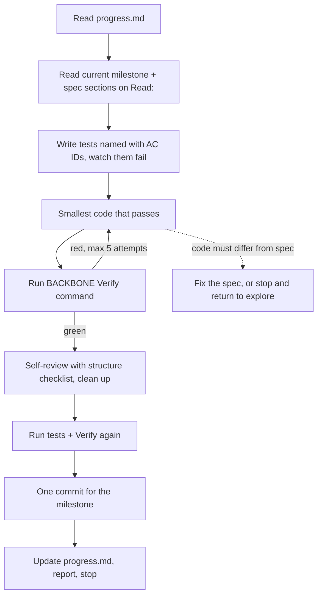

<p align="center">
  <h1 align="center">⚡ claudify-agent</h1>
  <p align="center">
    <strong>Spec-driven workflow for Claude Code: full-depth specs, disciplined milestone execution, behaviour you can verify, context loaded only when needed.</strong>
  </p>
  <p align="center">
    <a href="https://www.npmjs.com/package/claudify-agent"></a>
    <a href="https://www.npmjs.com/package/claudify-agent"></a>
    <a href="https://github.com/mytoandeptrai/claudify-agent/blob/main/LICENSE"></a>
  </p>
  <p align="center">
    English | <a href="README.vi.md">Tiếng Việt</a>
  </p>
</p>

---

## 💡 Overview

Claudify v2 combines three things:

- **SDD** — the specification is the source of truth for what the system must do.
- **BDD** — acceptance criteria are GIVEN / WHEN / THEN, and every one is proven by a test that names its ID.
- **Engineering workflow** — brainstorming, writing plans, executing plans milestone by milestone, verification, finishing a branch.

Design choices that keep the token cost down without thinning the spec:

- **Small always-loaded context.** Only `CLAUDE.md`, `BACKBONE.md` and one short `.claude/rules/core.md` load every session. Skills load when invoked.
- **One feature, one change.** No word cap on specs. A big feature gets more milestones, not more changes, so the spec → plan → apply → finish cycle runs once.
- **Milestone execution in the main session.** Each `/spec-execute` reads `progress.md`, the current milestone, and only the spec sections that milestone names.
- **One subagent in the whole workflow:** the end-of-feature reviewer in `/spec-verify`.

## 📦 Quick Start

```bash
npx claudify-agent@next init
```

> v2 is in preview under the npm `next` tag. `npx claudify-agent` without a tag still installs v1.

This installs:

- `CLAUDE.md` — the workflow routing table. An existing `CLAUDE.md` keeps its content; claudify manages only the block between `<!-- claudify:start -->` and
  `<!-- claudify:end -->`.
- `BACKBONE.md` — the project map (structure, glossary, docs index, capabilities, open changes, Verify command, invariants), loaded every session.
- `spec/config.md` — the project's spec conventions.
- `.claude/commands/` — the slash commands below, one line each.
- `.claude/skills/` — the 8 workflow skills.
- `.claude/rules/core.md` — the constraints of every task.
- `.claude/scripts/spec-check.mjs` — AC ↔ test traceability check.

Then run `/backbone-init` in Claude Code to fill `BACKBONE.md`.

### Upgrading from v1

v1 shipped rules, hooks and stack skills that v2 drops. Remove them, then install again:

```bash
npx claudify-agent@next uninstall   # removes v1 and v2 files, keeps BACKBONE.md and spec/
npx claudify-agent@next init
```

`init` keeps your existing `spec/config.md`; compare it with `templates/spec/config.md`. v1 changes were single files (`spec/changes/<name>.md`) and canonical
specs were `spec/specs/<capability>.md`; v2 uses `spec/changes/<name>/spec/spec.md` and `spec/specs/<capability>/spec.md`. Finish open v1 changes before you
upgrade, or move them by hand.

### Uninstall

```bash
npx claudify-agent@next uninstall          # keeps BACKBONE.md and spec/
npx claudify-agent@next uninstall --all    # also removes BACKBONE.md and spec/
```

It deletes only the files claudify installed (v1 and v2), the claudify block in `CLAUDE.md` and v1's hook entries in `.claude/settings.json`. Add `--yes` to
skip the prompt.

## 🔁 Workflow

```
/spec-explore → /spec-define → /spec-plan → /spec-execute (per milestone) → /spec-verify → /spec-ship
```

| Command                  | Skill            | Does                                                                                     |
|--------------------------|------------------|------------------------------------------------------------------------------------------|
| `/spec-explore <idea>` | brainstorming    | Asks one question per message, compares 2–3 options, ends with an approved design; on request saves it to `spec/discussions/`. |
| `/spec-define <change>`     | specification    | Creates `spec/changes/<change>/` (moves the saved discussion in) and writes `spec/`; no commit, no branch yet: `spec.md` with requirements and ACs, topic files when the work needs them. |
| `/spec-plan <change>`    | writing-plans    | Writes `plan.md` (milestones, tasks, the AC IDs and spec sections each one needs) and `progress.md`. |
| `/spec-execute <change>`   | executing-plans  | First run creates the branch and commits spec + plan. Then one milestone: tests first, code, Verify, self-review, one commit. Never pushes. |
| `/spec-status [change]`  | —                | Reads progress.md and reports where the change stands.                                    |
| `/spec-verify <change>`  | verification     | spec-check, full Verify, AC walk-through, one reviewer subagent. Only if all pass: Status `verified`, push the branch. |
| `/spec-ship <change>`  | finishing-branch | Syncs requirements into `spec/specs/`, archives the change, merge / PR / keep / discard. |
| `/debug <symptom>`       | debugging        | Root cause with evidence, red-first regression test, fix.                                |
| `/backbone-init`, `/backbone-sync` | —      | Create or refresh `BACKBONE.md`.                                                         |

Skills also trigger on their own when the work matches (see the table in `CLAUDE.md`). Bugs and trivial changes skip the spec.

### Layout

```
spec/
├── config.md                      project spec conventions
├── discussions/<date>-<topic>.md  saved brainstorms not yet a change (only when you ask to save)
├── specs/<capability>/spec.md     accepted requirements + ACs: the current truth
├── changes/<change>/
│   ├── discussion.md              the saved brainstorm, moved in by /spec-define (if any)
│   ├── spec/spec.md               requirements + ACs (the only owner), Why, Scope, Design
│   ├── spec/<topic>.md            data-model, api-contracts, business-rules, ... only when they have content
│   ├── plan.md                    milestones and tasks: intent, not code; points at spec sections
│   └── progress.md                execution state: current milestone, done, verification, blockers, findings
└── archive/YYYY-MM-DD-<change>/   finished changes
```

**Spec, plan, progress.** The spec says *what* the system must do and owns every AC. The plan says *how the work is cut*: milestones, component-level tasks,
which ACs and spec sections each milestone needs. Progress says *where execution stands*, by milestone and task ID, without copying the plan. Each fact has
one owner, so nothing drifts and nothing is read twice.

### Traceability (spec ↔ test)

ACs have IDs `<capability>/AC-<n>`. Tests name them: `describe("refund/AC-2: expired QR is refunded", ...)`, or `// refund/AC-2` in Go.

```bash
node .claude/scripts/spec-check.mjs spec/changes/add-refund   # one change
node .claude/scripts/spec-check.mjs                           # all canonical specs
```

## 🧠 Architecture

**Context loads in three layers, only as needed:**

| Layer | When | What |
|---|---|---|
| 1. Always | every session (~500 words + BACKBONE) | `CLAUDE.md` routing table, `.claude/rules/core.md`, `BACKBONE.md` |
| 2. On call | when a command or trigger invokes it | the one skill for the step, e.g. executing-plans |
| 3. Per milestone | inside `/spec-execute` | `progress.md` → the current milestone in `plan.md` → only the spec sections on its `Read:` line |

**The loop of one `/spec-execute` run:**



**Checks run locally, at the right moment.** No hooks fire on every edit. The Verify command runs at the end of each milestone, `spec-check.mjs` proves every AC has a test, and only the summary line and failures enter the context.

## 🧪 Example: refunds in a NestJS API, end to end

**Day 1 — agree the design.**

```
/spec-explore admins can refund a paid order
```

Claude reads the payment code and `spec/specs/payment/spec.md`, then asks one question at a time:

```
Claude: Can an admin refund part of an order, or only the full amount?
You:    Partial is allowed, total refunds never exceed the paid amount.
Claude: Is there a time limit after payment?
You:    30 days.
Claude: Two options: (1) refund synchronously through the provider API, (2) create a pending
        refund and confirm it by webhook. I recommend (2): the provider confirms refunds
        asynchronously and can take minutes. ...
```

After you approve each part of the design:

```
Claude: Save this discussion to spec/discussions/ so a new session can continue from it?
You:    yes
```

→ `spec/discussions/2026-11-18-refund.md`: goal, decisions with reasons, rejected options, the rules you confirmed, open questions.

**Day 1 — write the spec.** New session, or the same one:

```
/spec-define add-refund
```

Claude moves the discussion into `spec/changes/add-refund/discussion.md`, and writes `spec/changes/add-refund/spec/spec.md`:

```markdown
### refund (new)
#### ADDED Requirement: Admin refunds a paid order
An admin MUST be able to refund a paid order, in full or in part, within 30 days of payment.
- AC-1 partial refund: GIVEN a paid order of 100.00 WHEN an admin refunds 40.00 THEN a refund of 40.00 is pending
- AC-2 over-refund: GIVEN 80.00 already refunded on a 100.00 order WHEN an admin refunds 30.00 THEN it is rejected with 422
- AC-3 expired: GIVEN an order paid 31 days ago WHEN an admin refunds THEN it is rejected with 422
- AC-4 confirmed: GIVEN a pending refund WHEN the provider webhook reports success THEN the refund is completed
- AC-5 duplicate webhook: GIVEN a completed refund WHEN the same webhook arrives again THEN nothing changes
```

Because the work has a contract and a state machine, it also writes `api-contracts.md` and `data-model.md`. You review and approve.

**Day 1 — plan.**

```
/spec-plan add-refund
```

`plan.md` (excerpt):

```markdown
### M1: Create refunds through the API
Read: spec.md#requirements (refund), api-contracts.md#post-refunds, data-model.md#refund
Covers: refund/AC-1, AC-2, AC-3
- M1.1 Refund entity and repository, amounts in minor units
- M1.2 RefundService: refundable amount and 30-day window
- M1.3 POST /orders/:id/refunds, admin only
Done when: an admin can create a pending refund; invalid ones get 422

### M2: Confirm refunds by webhook
Read: spec.md#requirements (refund), api-contracts.md#provider-webhook
Covers: refund/AC-4, AC-5
...
```

**Day 2 — build, one milestone per run.** Nothing was committed so far; the first run creates `feature/add-refund` and commits the spec and plan.

```
/spec-execute add-refund
```

```
Claude: M1 done: refunds created through the API.
        Proof: 9 tests pass (refund/AC-1..AC-3), npm run lint && npm test green. Commit 3f2a91c.
        Next: M2 Confirm refunds by webhook.
```

You look at the diff, then run `/spec-execute add-refund` again. A new session works the same way: Claude reads `progress.md`, sees M1 ticked, and starts M2.

```markdown
# Progress: add-refund
Base: 9c1d0e2 | Current: M2 | Status: in progress

## Milestones
- [x] M1
- [ ] M2

## Done
- M1.1, M1.2, M1.3 — 3f2a91c

## Verification
- M1: npm run lint && npm test → 0 errors, 142/142 passed

## Findings
- M1: the provider returns `pending`, not `processing`; api-contracts.md updated
```

**Day 3 — verify and ship.**

```
/spec-verify add-refund     # spec-check 5/5 ACs covered, full Verify, one independent review; all green → push the branch
/spec-ship add-refund       # refund requirements → spec/specs/refund/spec.md, change archived, then merge / PR / keep / discard
```

**A bug, no spec needed:**

```
/debug refund webhook returns 500 when the order was deleted
```

Claude reproduces it, states "Cause: X. Evidence: Y.", writes a failing test, fixes it, and commits `fix: ...`.

## 📄 License

MIT © [jacob-tech](https://github.com/mytoandeptrai)
