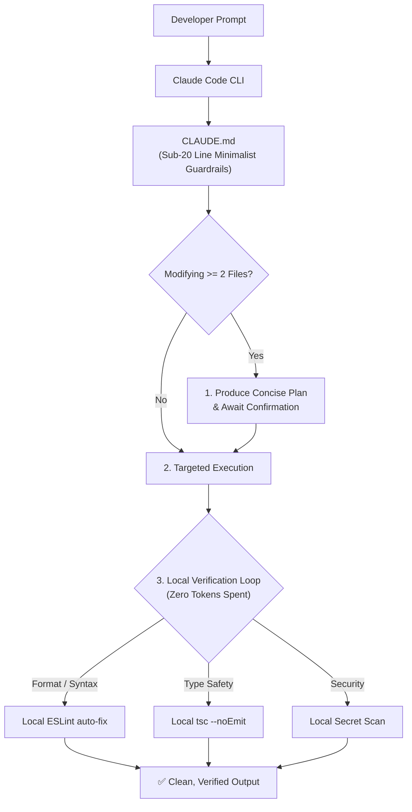

# ⚡ Claudify

> **Enterprise-grade workflow & context optimization framework for Claude Code, Claude Desktop, and autonomous AI coding agents.**

Inspired by research-backed agent instruction patterns, **Claudify** acts as the deterministic bridle and operating system for Claude: preventing context bloat, eliminating repetitive LLM token waste through zero-token local hooks, and enforcing systematic plan-first development.

---

## 📖 Hướng Dẫn Sử Dụng Chi Tiết (How to Use)

Có **3 cách dùng** tùy thuộc vào môi trường bạn sử dụng với Claude:

---

### Cách 1: Dùng với Claude Code CLI (Khuyên Dùng Nhất 🚀)

**Claude Code** là công cụ dòng lệnh (CLI agent) chính thức của Anthropic, có khả năng tự động đọc file, gọi terminal và tự sửa code.

#### 1. Áp dụng Claudify vào dự án của bạn:
Chỉ cần copy file `CLAUDE.md` và thư mục `.claude/` vào thư mục gốc dự án của bạn:
```bash
# Cách A: Dùng Git (nếu chưa publish npm)
git clone https://github.com/mytoandeptrai/claudify.git temp-claudify
cp temp-claudify/CLAUDE.md ./
cp -r temp-claudify/.claude ./
rm -rf temp-claudify

# Hoặc Cách B: Chạy CLI trực tiếp
npx github:mytoandeptrai/claudify init
```

#### 2. Khởi động Claude Code trong dự án:
Mở terminal tại thư mục dự án và gõ:
```bash
claude
```
👉 **Điều gì sẽ xảy ra?**
- Claude Code sẽ **tự động phát hiện và nạp file `CLAUDE.md`**.
- Bạn không cần cấu hình thêm gì cả. Toàn bộ cơ chế chặn tràn token, ép Plan Mode trước khi sửa nhiều file, và tự động gọi ESLint local sẽ hoạt động ngầm 100%.

---

### Cách 2: Dùng với Claude Desktop (Giao diện App trên máy tính)

Nếu bạn dùng ứng dụng **Claude Desktop** kèm tính năng Projects:

1. Mở **Claude Desktop** $\rightarrow$ Tạo một **Project** mới trỏ vào dự án của bạn.
2. Tại mục **Project Knowledge / Instructions**:
   - Copy toàn bộ nội dung trong file [CLAUDE.md](CLAUDE.md) dán vào ô **Custom Instructions**.
   - Thêm thư mục `.claude/` vào Project Files để Claude có thể tra cứu các Skills (`nextjs-guide`, `react-guide`, `mcp-mastery`...) khi cần.

---

### Cách 3: Kích hoạt hệ thống Tự Động Kiểm Tra (Zero-Token Verification)

Để tận dụng tối đa các script tự sửa lỗi code không tốn token của Claudify:

Thêm các script này vào `package.json` của dự án bạn:
```json
{
  "scripts": {
    "lint:fix": "eslint . --fix",
    "typecheck": "tsc --noEmit",
    "validate": "node .claude/scripts/auto-validate.js",
    "security": "node .claude/scripts/security-scan.js"
  }
}
```

Mỗi khi Claude hoàn thành việc sửa code, nó sẽ tự động chạy `npm run validate` để đảm bảo không có lỗi type hay cú pháp trước khi thông báo cho bạn.

---

## 🧠 Cơ Chế Hoạt Động (Architecture)



---

## 🛠️ Kho Kỹ Năng Đầy Đủ (Included 12 Skills)

Các kỹ năng được lưu trữ theo dạng modular trong `.claude/skills/` và chỉ được nạp khi có yêu cầu:

| Skill | Đường dẫn | Mô tả chi tiết |
| :--- | :--- | :--- |
| **Next.js Guide** | `.claude/skills/nextjs-guide/SKILL.md` | Chuẩn App Router, Server Components & Server Actions. |
| **React Guide** | `.claude/skills/react-guide/SKILL.md` | Single Source of Truth, tối ưu Render & Custom Hooks. |
| **Python Guide** | `.claude/skills/python-guide/SKILL.md` | Cấu trúc FastAPI, Django, Type hints & Pydantic. |
| **MCP Mastery** | `.claude/skills/mcp-mastery/SKILL.md` | Hướng dẫn kết nối và gọi các Model Context Protocol servers. |
| **Debug Optimizer** | `.claude/skills/debug-optimizer/SKILL.md` | Quy trình tìm nguyên nhân gốc rễ (Root Cause) 4 bước. |
| **Tool Selection** | `.claude/skills/tool-selection/SKILL.md` | Chiến lược chọn đúng tool nhằm giảm thiểu số lần gọi API. |
| **Plan Mastery** | `.claude/skills/plan-mode-mastery/SKILL.md` | Kỹ năng lập kế hoạch có hệ thống trước khi code. |
| **Vite Guide** | `.claude/skills/vite-guide/SKILL.md` | Cấu hình bundling SPA tối ưu hiệu năng. |
| **Electron & Tauri**| `.claude/skills/electron-guide/` & `tauri-guide/` | Quy chuẩn phát triển Desktop App bảo mật cao. |
| **Learning Loop** | `.claude/skills/learning-loop/SKILL.md` | Tự động rút kinh nghiệm sau các lần fix lỗi. |

---

## 📄 License
MIT © [mytoandeptrai](https://github.com/mytoandeptrai)
