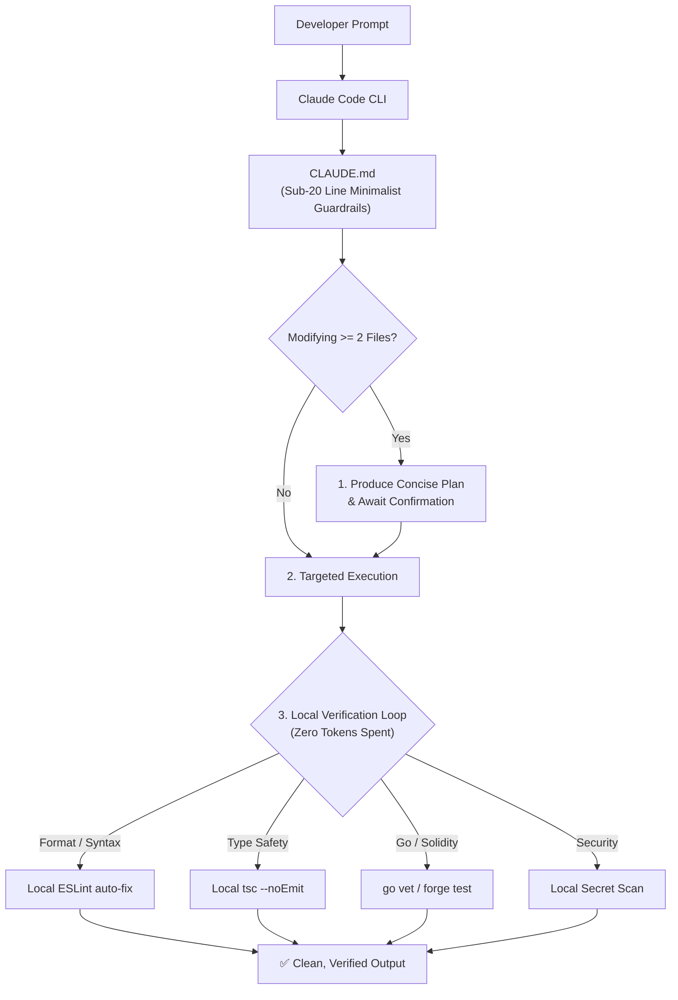

<p align="center">
  <h1 align="center">⚡ claudify-agent</h1>
  <p align="center">
    <strong>Enterprise-grade workflow & context optimization framework for Claude Code, Claude Desktop, and autonomous AI coding agents.</strong>
  </p>
  <p align="center">
    <a href="https://www.npmjs.com/package/claudify-agent"></a>
    <a href="https://www.npmjs.com/package/claudify-agent"></a>
    <a href="https://github.com/mytoandeptrai/claudify-agent/blob/main/LICENSE"></a>
  </p>
  <p align="center">
    English | <a href="README.vi.md">Tiếng Việt</a>
  </p>
</p>

---

## 💡 Overview

Inspired by empirical research on autonomous agent failure modes, **`claudify-agent`** acts as the deterministic bridle and operating system for Claude:
- **Prevents Context Bloat & Token Snowball:** Eliminates token waste and context rot by enforcing sub-20 line rules and on-demand modular skill loading (plain path references).
- **Plan-First Mandate:** Obligates Claude to formulate an explicit execution plan before modifying two or more files.
- **Zero-Token Local Verification:** Offloads formatting, ESLint corrections, typechecks, and security scans to local scripts rather than burning hundreds of thousands of tokens across LLM feedback loops.
- **Production Backend & Web3 Ready:** Comprehensive guidelines for high-throughput **Golang**, enterprise **NestJS**, distributed **Concurrency & Locking**, and secure **Solidity Smart Contracts**.

---

## 📦 Quick Start

Initialize `claudify-agent` into any existing repository or new project with a single command:

```bash
npx claudify-agent init
```

This bootstraps:
- `CLAUDE.md`: The central root steering file auto-loaded by Claude Code CLI. If your project already has one, your content is kept and Claudify only adds/updates a block between `<!-- claudify:start -->` and `<!-- claudify:end -->`.
- `BACKBONE.md`: Project map (overview, structure, docs index, capabilities, commands, invariants) loaded every session.
- `spec/config.md`: Rules for writing feature specs.
- `.claude/commands/`: Slash commands for the spec, backbone and learning workflow.
- `.claude/rules/`: 13 context-tiered rules governing planning, execution, and security.
- `.claude/skills/`: 12 on-demand domain skills (Golang, NestJS, Concurrency, Solidity, Next.js, etc.).
- `.claude/scripts/`: Local multi-language verification suite (`auto-validate.js`, `security-scan.js`).

---

## 🚀 How to Use

### 1. With Claude Code CLI (Recommended)
After running `npx claudify-agent init`, open your terminal in the project root and launch Claude:
```bash
claude
```
Claude Code automatically discovers `CLAUDE.md`. All guardrails, tiered rules, and verification loops run seamlessly in the background.

### 2. With Claude Desktop / Claude Projects
1. Open **Claude Desktop** and create a new **Project** pointing to your workspace.
2. Copy the content of [`CLAUDE.md`](CLAUDE.md) into the **Custom Instructions** box.
3. Attach the `.claude/` directory to Project Knowledge for on-demand skill retrieval.

---

## 🔁 Daily Workflow

Three tools, each with one job:

| Tool | Scope | When |
|---|---|---|
| `BACKBONE.md` | Whole project: what it is, where things live, which docs are current | Always loaded, every prompt |
| `spec/` | One feature at a time | Only when you run `/spec-*` (non-trivial features) |
| `/learn` | One mistake at a time | After you corrected the AI |

### Commands

| Command | What it does |
|---|---|
| `/backbone-init` | Scan the repo and draft `BACKBONE.md`. Run once per project. Shows a diff, writes after your approval. |
| `/backbone-sync [area]` | After work done without specs (bug fixes, small features): diff the code since `Last synced`, compare with the backbone and `spec/specs/`, ask about gaps, update the backbone after approval. Never edits archived specs. |
| `/spec-new <name> <goal>` | Draft ONE file `spec/changes/<name>.md`: Why, Scope/Non-goals, Requirements per capability (ADDED/MODIFIED/REMOVED + GIVEN/WHEN/THEN), Design, Risks, Tasks + DoD. ~800 words; proposes splitting big changes. No code. |
| `/spec-apply <name> [task]` | Implement the next unchecked task, run its DoD, tick it. One task per call. |
| `/spec-archive <name>` | Merge the requirements into `spec/specs/<capability>.md` (current truth), move the change to `spec/changes/archive/`, update the backbone. |
| `/learn [lesson]` | Turn a correction into one rule in the right place (backbone invariant, skill `## Lessons`, or `.claude/rules/lessons.md`). Shows a diff first. |

Bugs and trivial tasks: just prompt as usual. No spec needed.

### Layout

```
BACKBONE.md                     ← project map (always loaded)
spec/
├── config.md                   ← how to write specs
├── changes/
│   ├── add-refund.md           ← in progress
│   └── archive/2026-11-08-add-export.md   ← history
└── specs/
    └── data-export.md          ← current truth, merged on archive
```

### Example: a feature, end to end

```text
> /spec-new add-refund Users can request a refund for a failed order within 7 days

AI: Reads BACKBONE.md (already in context), spec/config.md, spec/specs/orders.md.
    Q: Partial refunds in scope? Who approves: auto or admin?
You: Full refund only, auto-approve.
AI: Wrote spec/changes/add-refund.md (640 words, 4 tasks). Added it to "Open changes".
    Approve the tasks?

> /spec-apply add-refund
AI: Task 1 done: POST /orders/:id/refund + Zod schema.
    Proof: npm run lint && npm run typecheck && npm test -> 42 passed. Next: task 2.

(AI used float for the amount; you correct it)
> /learn money is always integer cents, never float
AI: Proposed diff in BACKBONE.md Invariants:
    + - Money amounts are integer cents; never float.
    Write it?   -> yes

> /spec-archive add-refund
AI: Merged 2 ADDED requirements into spec/specs/orders.md,
    moved the change to spec/changes/archive/2026-11-08-add-refund.md,
    updated Capabilities in BACKBONE.md.
```

### Example: after a bug fix without spec

```text
> fix: export CSV breaks on commas in names
AI: Fixed + test. This added docs/csv-format.md, consider /backbone-sync.

> /backbone-sync
AI: 6 commits since a1b2c3d. Gaps:
    - Docs index: docs/csv-format.md missing
    - Commands: `npm run test:e2e` added in CI
    Q: Is docs/export-v1.md still current? It contradicts src/export/csv.ts.
You: outdated.
AI: Diff for BACKBONE.md (+3 lines, Last synced: e4f5a6b). Write it?
```

---

## 🧠 Architecture & ReAct Loop



---

## 🛠️ Included 12 Production Skills

| Skill | Path | Focus Area |
| :--- | :--- | :--- |
| **Backend Concurrency** | `.claude/skills/backend-concurrency/SKILL.md` | Race conditions, Distributed Redis Lock, Deadlocks, Idempotency. |
| **Golang Backend** | `.claude/skills/golang-guide/SKILL.md` | Standard project layout, Worker Pools, Concurrency safety, Context. |
| **NestJS Enterprise** | `.claude/skills/nestjs-guide/SKILL.md` | Clean module boundaries, TypeORM QueryRunner transactions, DTO safety. |
| **Solidity Smart Contracts** | `.claude/skills/solidity-guide/SKILL.md` | CEI pattern, ReentrancyGuard, EVM gas optimization, Foundry tests. |
| **Next.js Guide** | `.claude/skills/nextjs-guide/SKILL.md` | App Router, React Server Components (RSC), and Server Actions. |
| **React Guide** | `.claude/skills/react-guide/SKILL.md` | Single Source of Truth, render optimization & Custom Hooks. |
| **Python Guide** | `.claude/skills/python-guide/SKILL.md` | FastAPI, Django, Type hints & Pydantic. |
| **MCP Mastery** | `.claude/skills/mcp-mastery/SKILL.md` | Model Context Protocol configuration and tool calling patterns. |
| **Debug Optimizer** | `.claude/skills/debug-optimizer/SKILL.md` | 4-step systematic root-cause debugging protocol. |
| **Security Guide** | `.claude/skills/security-guide/SKILL.md` | OWASP Top 10: secrets, injection, auth checks, input validation. |
| **Tool Selection** | `.claude/skills/tool-selection/SKILL.md` | Decision matrix to minimize excessive LLM tool calls. |
| **Plan Mastery** | `.claude/skills/plan-mode-mastery/SKILL.md` | Systematic research and execution planning before code generation. |
| **Vite Guide** | `.claude/skills/vite-guide/SKILL.md` | Modern SPA build optimization and bundling practices. |

---

## 📄 License

MIT © [jacob-tech](https://github.com/mytoandeptrai)
