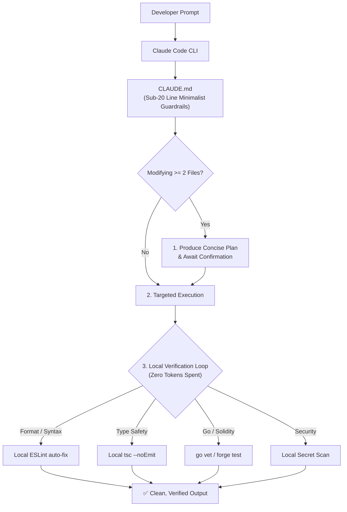

<p align="center">
  <h1 align="center">⚡ claudify-agent</h1>
  <p align="center">
    <strong>Enterprise-grade workflow & context optimization framework for Claude Code, Claude Desktop, and autonomous AI coding agents.</strong>
  </p>
  <p align="center">
    <a href="https://www.npmjs.com/package/claudify-agent"></a>
    <a href="https://www.npmjs.com/package/claudify-agent"></a>
    <a href="https://github.com/mytoandeptrai/claudify-agent/blob/main/LICENSE"></a>
  </p>
  <p align="center">
    English | <a href="README.vi.md">Tiếng Việt</a>
  </p>
</p>

---

## 💡 Overview

Inspired by empirical research on autonomous agent failure modes, **`claudify-agent`** acts as the deterministic bridle and operating system for Claude:
- **Prevents Context Bloat & Token Snowball:** Eliminates token waste and context rot by enforcing sub-20 line rules and on-demand `@path` modular skill loading.
- **Plan-First Mandate:** Obligates Claude to formulate an explicit execution plan before modifying two or more files.
- **Zero-Token Local Verification:** Offloads formatting, ESLint corrections, typechecks, and security scans to local scripts rather than burning hundreds of thousands of tokens across LLM feedback loops.
- **Production Backend & Web3 Ready:** Comprehensive guidelines for high-throughput **Golang**, enterprise **NestJS**, distributed **Concurrency & Locking**, and secure **Solidity Smart Contracts**.

---

## 📦 Quick Start

Initialize `claudify-agent` into any existing repository or new project with a single command:

```bash
npx claudify-agent init
```

This bootstraps:
- `CLAUDE.md`: The central root steering file auto-loaded by Claude Code CLI.
- `.claude/rules/`: 13 context-tiered rules governing planning, execution, and security.
- `.claude/skills/`: 12 on-demand domain skills (Golang, NestJS, Concurrency, Solidity, Next.js, etc.).
- `.claude/scripts/`: Local multi-language verification suite (`auto-validate.js`, `security-scan.js`).

---

## 🚀 How to Use

### 1. With Claude Code CLI (Recommended)
After running `npx claudify-agent init`, open your terminal in the project root and launch Claude:
```bash
claude
```
Claude Code automatically discovers `CLAUDE.md`. All guardrails, tiered rules, and verification loops run seamlessly in the background.

### 2. With Claude Desktop / Claude Projects
1. Open **Claude Desktop** and create a new **Project** pointing to your workspace.
2. Copy the content of [`CLAUDE.md`](CLAUDE.md) into the **Custom Instructions** box.
3. Attach the `.claude/` directory to Project Knowledge for on-demand skill retrieval.

---

## 🧠 Architecture & ReAct Loop



---

## 🛠️ Included 12 Production Skills

| Skill | Path | Focus Area |
| :--- | :--- | :--- |
| **Backend Concurrency** | `.claude/skills/backend-concurrency/SKILL.md` | Race conditions, Distributed Redis Lock, Deadlocks, Idempotency. |
| **Golang Backend** | `.claude/skills/golang-guide/SKILL.md` | Standard project layout, Worker Pools, Concurrency safety, Context. |
| **NestJS Enterprise** | `.claude/skills/nestjs-guide/SKILL.md` | Clean module boundaries, TypeORM QueryRunner transactions, DTO safety. |
| **Solidity Smart Contracts** | `.claude/skills/solidity-guide/SKILL.md` | CEI pattern, ReentrancyGuard, EVM gas optimization, Foundry tests. |
| **Next.js Guide** | `.claude/skills/nextjs-guide/SKILL.md` | App Router, React Server Components (RSC), and Server Actions. |
| **React Guide** | `.claude/skills/react-guide/SKILL.md` | Single Source of Truth, render optimization & Custom Hooks. |
| **Python Guide** | `.claude/skills/python-guide/SKILL.md` | FastAPI, Django, Type hints & Pydantic. |
| **MCP Mastery** | `.claude/skills/mcp-mastery/SKILL.md` | Model Context Protocol configuration and tool calling patterns. |
| **Debug Optimizer** | `.claude/skills/debug-optimizer/SKILL.md` | 4-step systematic root-cause debugging protocol. |
| **Security Guide** | `.claude/skills/security-guide/SKILL.md` | OWASP Top 10: secrets, injection, auth checks, input validation. |
| **Tool Selection** | `.claude/skills/tool-selection/SKILL.md` | Decision matrix to minimize excessive LLM tool calls. |
| **Plan Mastery** | `.claude/skills/plan-mode-mastery/SKILL.md` | Systematic research and execution planning before code generation. |
| **Vite Guide** | `.claude/skills/vite-guide/SKILL.md` | Modern SPA build optimization and bundling practices. |

---

## 📄 License

MIT © [jacob-tech](https://github.com/mytoandeptrai)
