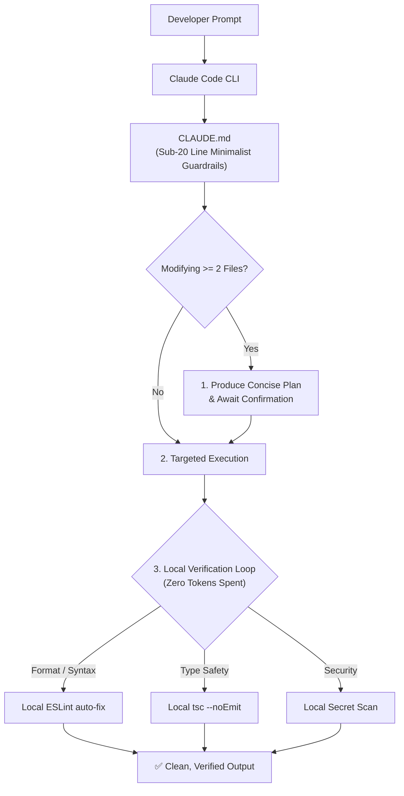

# ⚡ Claudify

> **Enterprise-grade workflow & context optimization framework for Claude Code, Claude Desktop, and autonomous AI coding agents.**

Inspired by research-backed agent instruction patterns, **Claudify** acts as the deterministic bridle and operating system for Claude: preventing context bloat, eliminating repetitive LLM token waste through zero-token local hooks, and enforcing systematic plan-first development.

---

## 🚀 Key Advantages

- **🛡️ Token Snowball Prevention:** Eliminates conversational fluff and enforces strict sub-20 line rules. Prevents Claude from blindly hoovering up entire directory trees.
- **📋 Plan-First Protocol:** Automatically obligates Claude to output an explicit implementation plan before touching two or more files.
- **⚡ Zero-Token Local Verification:** Offloads formatting, ESLint fixes, and type checks to local scripts rather than burning hundreds of thousands of tokens across LLM feedback loops.
- **📚 On-Demand Skills Directory:** Structured knowledge modules for Next.js, React, Root Cause Debugging, and OWASP Top 10 Security.
- **🧩 MCP Native:** Built from the ground up to pair with Anthropic's Model Context Protocol (MCP) servers.

---

## 📦 Quick Start

### 1. Initialize in Any Project
You can bootstrap Claudify directly into any existing repository or new project:

```bash
# Clone and link, or run via npx:
npx claudify init
```

This installs:
- `CLAUDE.md`: The central steering file auto-loaded by Claude Code.
- `.claude/skills/`: Tech-specific best practices (Next.js, React, Security, Debugging).
- `.claude/scripts/`: Local verification pipeline (`auto-validate.js`, `security-scan.js`).

### 2. Available Local Scripts
Add these to your `package.json` for deterministic agent verification:
```json
{
  "scripts": {
    "validate": "node .claude/scripts/auto-validate.js",
    "security": "node .claude/scripts/security-scan.js"
  }
}
```

---

## 🧠 Architecture & How It Works



---

## 🛠️ Included Skills

| Skill File | Description |
| :--- | :--- |
| [`.claude/skills/nextjs.md`](.claude/skills/nextjs.md) | App Router, React Server Components (RSC), and Server Actions. |
| [`.claude/skills/react.md`](.claude/skills/react.md) | Single Source of Truth state patterns, memoization guidelines. |
| [`.claude/skills/security.md`](.claude/skills/security.md) | OWASP Top 10, secret leak defense, and input sanitization. |
| [`.claude/skills/debug-optimizer.md`](.claude/skills/debug-optimizer.md) | 4-step systematic root-cause debugging protocol. |

---

## 📄 License
MIT © [mytoandeptrai](https://github.com/mytoandeptrai)
