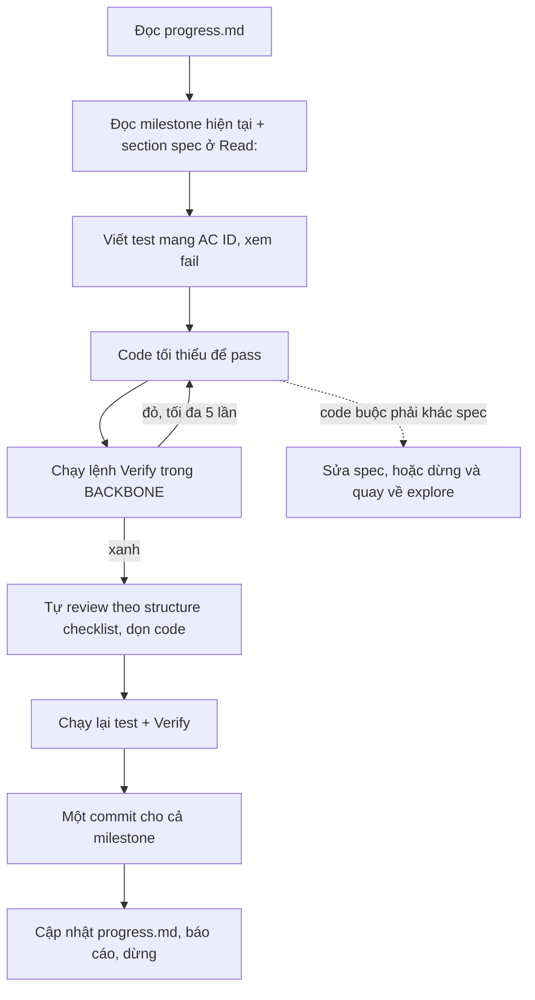

<p align="center">
  <h1 align="center">⚡ claudify-agent</h1>
  <p align="center">
    <strong>Workflow spec-driven cho Claude Code: spec đủ chiều sâu, thực thi có kỷ luật theo milestone, behavior kiểm chứng được, context chỉ nạp khi cần.</strong>
  </p>
  <p align="center">
    <a href="https://www.npmjs.com/package/claudify-agent"></a>
    <a href="https://www.npmjs.com/package/claudify-agent"></a>
    <a href="https://github.com/mytoandeptrai/claudify-agent/blob/main/LICENSE"></a>
  </p>
  <p align="center">
    <a href="README.md">English</a> | Tiếng Việt
  </p>
</p>

---

## 💡 Tổng quan

Claudify v2 kết hợp ba thứ:

- **SDD** — specification là nguồn sự thật về những gì hệ thống phải làm.
- **BDD** — acceptance criteria viết dạng GIVEN / WHEN / THEN, mỗi AC được chứng minh bằng một test mang ID của nó.
- **Engineering workflow** — brainstorming, writing plans, thực thi plan theo từng milestone, verification, finishing branch.

Các quyết định thiết kế giúp giảm token mà không làm mỏng spec:

- **Context nạp sẵn nhỏ.** Mỗi phiên chỉ nạp `CLAUDE.md`, `BACKBONE.md` và một file ngắn `.claude/rules/core.md`. Skill chỉ nạp khi được gọi.
- **Một feature là một change.** Không giới hạn số từ của spec. Feature lớn có nhiều milestone hơn, không bị chia thành nhiều change, nên chu trình
  spec → plan → apply → finish chỉ chạy một lần.
- **Thực thi theo milestone trong main session.** Mỗi lần `/spec-execute` đọc `progress.md`, milestone hiện tại, và chỉ những section spec mà milestone đó cần.
- **Cả workflow chỉ có một subagent:** reviewer cuối feature trong `/spec-verify`.

## 📦 Bắt đầu nhanh

```bash
npx claudify-agent@latest init
```

Lệnh này cài:

- `CLAUDE.md` — bảng điều hướng workflow. Nếu project đã có `CLAUDE.md`, nội dung của bạn được giữ nguyên; claudify chỉ quản lý khối giữa
  `<!-- claudify:start -->` và `<!-- claudify:end -->`.
- `BACKBONE.md` — bản đồ project (cấu trúc, glossary, docs index, capabilities, open changes, lệnh Verify, invariants), nạp mỗi phiên.
- `spec/config.md` — quy ước viết spec của project.
- `.claude/commands/` — các slash command bên dưới, mỗi file một dòng.
- `.claude/skills/` — 8 workflow skill.
- `.claude/rules/core.md` — các ràng buộc áp dụng cho mọi task.
- `.claude/scripts/spec-check.mjs` — kiểm tra truy vết AC ↔ test.

Sau đó chạy `/backbone-init` trong Claude Code để điền `BACKBONE.md`.

### Nâng cấp từ v1

v1 cài rules, hooks và các skill theo stack mà v2 đã bỏ. Gỡ chúng rồi cài lại:

```bash
npx claudify-agent@latest uninstall   # gỡ file của v1 và v2, giữ BACKBONE.md và spec/
npx claudify-agent@latest init
```

`init` giữ nguyên `spec/config.md` hiện có; hãy so nó với `templates/spec/config.md`. Ở v1, mỗi change là một file (`spec/changes/<name>.md`) và canonical spec là
`spec/specs/<capability>.md`; v2 dùng `spec/changes/<name>/spec/spec.md` và `spec/specs/<capability>/spec.md`. Hoàn tất các change v1 đang mở trước khi nâng
cấp, hoặc chuyển chúng bằng tay.

### Gỡ cài đặt

```bash
npx claudify-agent uninstall          # giữ BACKBONE.md và spec/
npx claudify-agent uninstall --all    # xoá luôn BACKBONE.md và spec/
```

Lệnh này chỉ xoá các file claudify đã cài (v1 và v2), khối claudify trong `CLAUDE.md` và các hook entry của v1 trong `.claude/settings.json`. Thêm `--yes` để bỏ
qua bước xác nhận.

## 🔁 Workflow

```
/spec-explore → /spec-define → /spec-plan → /spec-execute (từng milestone) → /spec-verify → /spec-ship
```

| Command                  | Skill            | Làm gì                                                                                   |
|--------------------------|------------------|------------------------------------------------------------------------------------------|
| `/spec-explore <ý tưởng>` | brainstorming | Hỏi từng câu, đưa 2–3 phương án, chốt design được duyệt; nếu bạn đồng ý thì lưu vào `spec/discussions/`. |
| `/spec-define <change>`     | specification    | Tạo `spec/changes/<change>/` (chuyển discussion đã lưu vào) và viết `spec/`; chưa commit, chưa tạo branch: `spec.md` chứa requirements và AC, thêm topic file khi cần. |
| `/spec-plan <change>`    | writing-plans    | Viết `plan.md` (milestone, task, AC ID và section spec mỗi milestone cần) và `progress.md`. |
| `/spec-execute <change>`   | executing-plans  | Lần đầu tạo branch và commit spec + plan. Sau đó mỗi lần một milestone: test trước, code, Verify, tự review, một commit. Không push. |
| `/spec-status [change]`  | —                | Đọc progress.md và báo change đang ở đâu.                                                 |
| `/spec-verify <change>`  | verification     | spec-check, Verify đầy đủ, rà từng AC, một reviewer subagent. Chỉ khi tất cả pass: Status `verified`, push branch. |
| `/spec-ship <change>`  | finishing-branch | Đồng bộ requirements vào `spec/specs/`, archive change, merge / PR / giữ / huỷ.          |
| `/debug <triệu chứng>`   | debugging        | Tìm root cause có bằng chứng, viết regression test fail trước, rồi sửa.                  |
| `/backbone-init`, `/backbone-sync` | —      | Tạo hoặc làm mới `BACKBONE.md`.                                                           |

Skill cũng tự kích hoạt khi công việc khớp (xem bảng trong `CLAUDE.md`). Bug và thay đổi nhỏ không cần spec.

### Cấu trúc

```
spec/
├── config.md                      quy ước spec của project
├── discussions/<ngày>-<chủ-đề>.md  brainstorm đã lưu, chưa thành change (chỉ khi bạn đồng ý lưu)
├── specs/<capability>/spec.md     requirements + AC đã chấp nhận: sự thật hiện tại
├── changes/<change>/
│   ├── discussion.md              brainstorm đã lưu, /spec-define chuyển vào (nếu có)
│   ├── spec/spec.md               requirements + AC (nơi sở hữu duy nhất), Why, Scope, Design
│   ├── spec/<topic>.md            data-model, api-contracts, business-rules, ... chỉ khi có nội dung
│   ├── plan.md                    milestone và task: ý định, không phải code; trỏ tới section spec
│   └── progress.md                trạng thái thực thi: milestone hiện tại, đã xong, verification, blocker, findings
└── archive/YYYY-MM-DD-<change>/   các change đã xong
```

**Spec, plan, progress.** Spec nói hệ thống *phải làm gì* và sở hữu mọi AC. Plan nói *công việc được chia thế nào*: milestone, task ở mức component, mỗi
milestone cần AC và section spec nào. Progress nói *thực thi đang ở đâu*, theo ID milestone và task, không chép lại plan. Mỗi thông tin chỉ có một nơi sở hữu,
nên không lệch nhau và không phải đọc hai lần.

### Truy vết (spec ↔ test)

AC có ID `<capability>/AC-<n>`. Test ghi ID đó: `describe("refund/AC-2: expired QR is refunded", ...)`, hoặc `// refund/AC-2` trong Go.

```bash
node .claude/scripts/spec-check.mjs spec/changes/add-refund   # một change
node .claude/scripts/spec-check.mjs                           # toàn bộ canonical spec
```

## 🧠 Kiến trúc

**Context nạp theo ba tầng, chỉ khi cần:**

| Tầng | Khi nào | Nạp gì |
|---|---|---|
| 1. Luôn nạp | mọi phiên (~500 từ + BACKBONE) | bảng điều hướng `CLAUDE.md`, `.claude/rules/core.md`, `BACKBONE.md` |
| 2. Khi được gọi | khi lệnh hoặc trigger gọi tới | đúng skill của bước đó, vd. executing-plans |
| 3. Theo milestone | trong `/spec-execute` | `progress.md` → milestone hiện tại trong `plan.md` → chỉ các section spec ở dòng `Read:` |

**Vòng lặp của một lần `/spec-execute`:**



**Kiểm tra chạy cục bộ, đúng thời điểm.** Không có hook chạy sau mỗi lần sửa file. Lệnh Verify chạy cuối mỗi milestone, `spec-check.mjs` chứng minh mọi AC đều có test, và chỉ dòng tổng kết cùng các lỗi được đưa vào context.

## 🧪 Ví dụ: hoàn tiền trong một API NestJS, từ đầu đến cuối

**Ngày 1 — chốt design.**

```
/spec-explore admin được hoàn tiền cho đơn đã thanh toán
```

Claude đọc code payment và `spec/specs/payment/spec.md`, rồi hỏi từng câu một:

```
Claude: Admin được hoàn một phần hay chỉ hoàn toàn bộ?
Bạn:    Được hoàn một phần, tổng hoàn không vượt quá số tiền đã trả.
Claude: Có giới hạn thời gian sau khi thanh toán không?
Bạn:    30 ngày.
Claude: Hai phương án: (1) gọi API hoàn tiền đồng bộ, (2) tạo refund ở trạng thái pending
        và xác nhận qua webhook. Tôi đề xuất (2): cổng thanh toán xác nhận bất đồng bộ,
        có thể mất vài phút. ...
```

Sau khi bạn duyệt từng phần của design:

```
Claude: Lưu discussion này vào spec/discussions/ để phiên sau tiếp tục không?
Bạn:    có
```

→ `spec/discussions/2026-11-18-refund.md`: mục tiêu, quyết định kèm lý do, phương án đã loại, business rule bạn đã xác nhận, câu hỏi còn mở.

**Ngày 1 — viết spec.** Phiên mới hoặc cùng phiên:

```
/spec-define add-refund
```

Claude chuyển discussion vào `spec/changes/add-refund/discussion.md`, và viết `spec/changes/add-refund/spec/spec.md`:

```markdown
### refund (new)
#### ADDED Requirement: Admin refunds a paid order
An admin MUST be able to refund a paid order, in full or in part, within 30 days of payment.
- AC-1 partial refund: GIVEN a paid order of 100.00 WHEN an admin refunds 40.00 THEN a refund of 40.00 is pending
- AC-2 over-refund: GIVEN 80.00 already refunded on a 100.00 order WHEN an admin refunds 30.00 THEN it is rejected with 422
- AC-3 expired: GIVEN an order paid 31 days ago WHEN an admin refunds THEN it is rejected with 422
- AC-4 confirmed: GIVEN a pending refund WHEN the provider webhook reports success THEN the refund is completed
- AC-5 duplicate webhook: GIVEN a completed refund WHEN the same webhook arrives again THEN nothing changes
```

Vì có contract API và state machine, Claude viết thêm `api-contracts.md` và `data-model.md`. Bạn review và duyệt.

**Ngày 1 — lên plan.**

```
/spec-plan add-refund
```

`plan.md` (trích):

```markdown
### M1: Create refunds through the API
Read: spec.md#requirements (refund), api-contracts.md#post-refunds, data-model.md#refund
Covers: refund/AC-1, AC-2, AC-3
- M1.1 Refund entity and repository, amounts in minor units
- M1.2 RefundService: refundable amount and 30-day window
- M1.3 POST /orders/:id/refunds, admin only
Done when: an admin can create a pending refund; invalid ones get 422

### M2: Confirm refunds by webhook
Read: spec.md#requirements (refund), api-contracts.md#provider-webhook
Covers: refund/AC-4, AC-5
...
```

**Ngày 2 — code, mỗi lần chạy một milestone.** Đến lúc này chưa có commit nào; lần chạy đầu tạo `feature/add-refund` và commit spec cùng plan.

```
/spec-execute add-refund
```

```
Claude: M1 xong: tạo refund qua API.
        Proof: 9 test pass (refund/AC-1..AC-3), npm run lint && npm test xanh. Commit 3f2a91c.
        Tiếp theo: M2 xác nhận refund qua webhook.
```

Bạn xem diff, rồi chạy lại `/spec-execute add-refund`. Phiên mới cũng vậy: Claude đọc `progress.md`, thấy M1 đã tick, và bắt đầu M2.

```markdown
# Progress: add-refund
Base: 9c1d0e2 | Current: M2 | Status: in progress

## Milestones
- [x] M1
- [ ] M2

## Done
- M1.1, M1.2, M1.3 — 3f2a91c

## Verification
- M1: npm run lint && npm test → 0 errors, 142/142 passed

## Findings
- M1: the provider returns `pending`, not `processing`; api-contracts.md updated
```

**Ngày 3 — verify và ship.**

```
/spec-verify add-refund     # spec-check 5/5 AC có test, Verify đầy đủ, một lượt review độc lập; tất cả xanh → push branch
/spec-ship add-refund       # requirement vào spec/specs/refund/spec.md, archive change, rồi merge / PR / giữ / huỷ
```

**Sửa bug, không cần spec:**

```
/debug webhook hoàn tiền trả 500 khi đơn hàng đã bị xoá
```

Claude tái hiện lỗi, nêu "Nguyên nhân: X. Bằng chứng: Y.", viết test fail trước, sửa, rồi commit `fix: ...`.

## 📄 License

MIT © [jacob-tech](https://github.com/mytoandeptrai)
