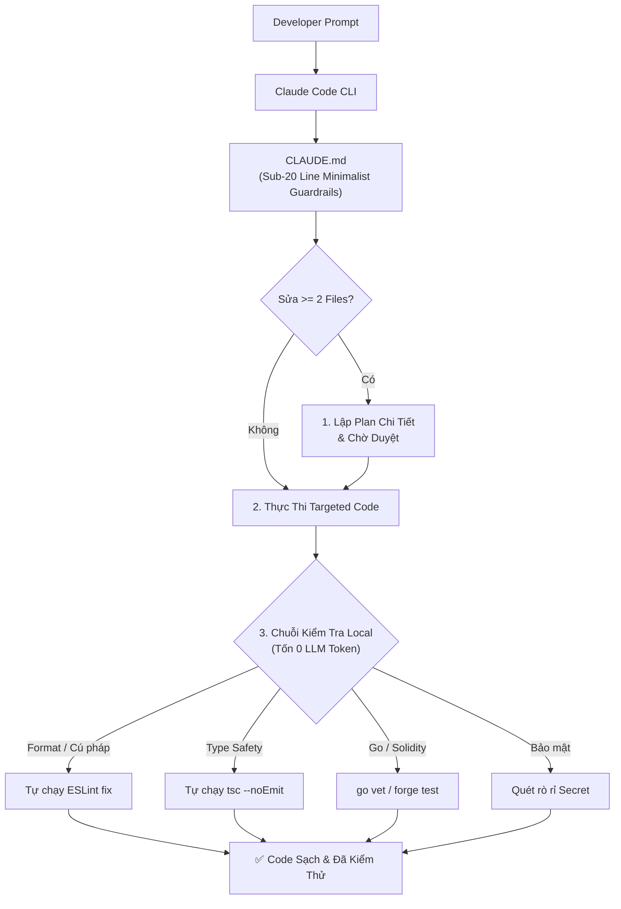

<p align="center">
  <h1 align="center">⚡ claudify-agent</h1>
  <p align="center">
    <strong>Framework tối ưu hóa ngữ cảnh và quy trình làm việc chuẩn doanh nghiệp cho Claude Code, Claude Desktop và các AI Coding Agent tự chủ.</strong>
  </p>
  <p align="center">
    <a href="https://www.npmjs.com/package/claudify-agent"></a>
    <a href="https://www.npmjs.com/package/claudify-agent"></a>
    <a href="https://github.com/mytoandeptrai/claudify-agent/blob/main/LICENSE"></a>
  </p>
  <p align="center">
    <a href="README.md">English</a> | Tiếng Việt
  </p>
</p>

---

## 💡 Tổng Quan

Lấy cảm hứng từ các nghiên cứu thực nghiệm về thất bại của AI Agent khi viết code, **`claudify-agent`** đóng vai trò là "dây cương và hệ điều hành" cho Claude:
- **Chống Tràn Ngữ Cảnh & Hiệu Ứng Tuyết Lăn (Context Snowball):** Triệt tiêu lãng phí token bằng nguyên tắc luật dưới 20 dòng và nạp modular skill theo nhu cầu qua tham chiếu đường dẫn thường.
- **Bắt Buộc Lập Kế Hoạch (Plan-First):** Ép Claude phải xuất ra một kế hoạch (Plan) cụ thể trước khi được phép sửa từ 2 file trở lên.
- **Xác Thực Cục Bộ Tốn 0 Token (Zero-Token Verification):** Đẩy toàn bộ việc sửa format, ESLint, kiểm tra type TypeScript và quét bảo mật cho các script local chạy trên máy tính thay vì đốt hàng trăm ngàn token qua các lượt chat lặp lại của AI.
- **Sẵn Sàng Cho Production Backend & Web3:** Cung cấp sẵn các cẩm nang chuẩn cho hệ thống **Golang** hiệu năng cao, **NestJS** doanh nghiệp, xử lý **Concurrency & Khóa phân tán (Locking)**, và hợp đồng thông minh **Solidity** an toàn.

---

## 📦 Khởi Tạo Nhanh (Quick Start)

Khởi tạo `claudify-agent` vào bất kỳ dự án mới hoặc có sẵn nào chỉ bằng 1 dòng lệnh duy nhất:

```bash
npx claudify-agent init
```

Lệnh này sẽ tự động thiết lập:
- `CLAUDE.md`: File điều phối trung tâm tự động được nạp bởi Claude Code CLI. Nếu dự án đã có `CLAUDE.md`, nội dung của bạn được giữ nguyên; Claudify chỉ thêm/cập nhật khối nằm giữa `<!-- claudify:start -->` và `<!-- claudify:end -->`.
- `BACKBONE.md`: Bản đồ dự án (tổng quan, cấu trúc, docs index, capabilities, lệnh, bất biến), nạp mỗi session.
- `spec/config.md`: Quy tắc viết spec cho feature.
- `.claude/commands/`: Slash command cho workflow spec, backbone và tự học từ lỗi.
- `.claude/rules/`: 13 quy tắc phân tầng kiểm soát quá trình lập plan, thực thi và bảo mật.
- `.claude/skills/`: 15 cẩm nang chuyên sâu theo từng công nghệ (Golang, NestJS, Concurrency, Solidity, Next.js...).
- `.claude/scripts/`: Bộ công cụ tự động kiểm tra code đa ngôn ngữ (`auto-validate.js`, `security-scan.js`).

---

## 🚀 Hướng Dẫn Sử Dụng

### 1. Dùng với Claude Code CLI (Khuyên dùng nhất)
Sau khi chạy `npx claudify-agent init`, mở terminal tại thư mục dự án và gõ:
```bash
claude
```
Claude Code sẽ tự động nhận diện `CLAUDE.md`. Toàn bộ luật bảo vệ, phân tầng ngữ cảnh và chuỗi kiểm tra tự động sẽ chạy ngầm mà không cần cấu hình thêm.

### 2. Dùng với Claude Desktop / Claude Projects
1. Mở **Claude Desktop** $\rightarrow$ Tạo một **Project** trỏ vào thư mục code của bạn.
2. Sao chép toàn bộ nội dung file [`CLAUDE.md`](CLAUDE.md) dán vào ô **Custom Instructions**.
3. Đính kèm thư mục `.claude/` vào Project Files để Claude tra cứu kỹ năng khi cần.

---

## 🔁 Workflow Hằng Ngày

Ba công cụ, mỗi cái một việc:

| Công cụ | Phạm vi | Khi nào |
|---|---|---|
| `BACKBONE.md` | Toàn dự án: là gì, cái gì nằm đâu, docs nào còn đúng | Luôn được nạp, mọi prompt |
| `spec/` | Từng feature | Chỉ khi bạn gõ `/spec-*` (feature không tầm thường) |
| `/learn` | Từng lỗi | Sau khi bạn đã sửa lỗi của AI |

### Các lệnh

| Lệnh | Làm gì |
|---|---|
| `/backbone-init` | Quét repo và viết `BACKBONE.md`. Chạy 1 lần mỗi dự án. Cho xem diff, bạn duyệt mới ghi. |
| `/backbone-sync [vùng]` | Sau khi làm việc không qua spec (fix bug, feature nhỏ): diff code từ `Last synced`, so với backbone và `spec/specs/`, hỏi chỗ thiếu, cập nhật backbone sau khi bạn duyệt. Không bao giờ sửa spec đã archive. |
| `/spec-new <tên> <mục tiêu>` | Viết MỘT file `spec/changes/<tên>.md`: Why, Scope/Non-goals, Requirements theo capability (ADDED/MODIFIED/REMOVED + GIVEN/WHEN/THEN), Design, Risks, Tasks + DoD. ~800 từ; tự đề xuất tách change lớn. Không code. |
| `/spec-apply <tên> [task]` | Làm task chưa tick tiếp theo, chạy DoD, tick. Mỗi lần một task. |
| `/spec-archive <tên>` | Gộp requirements vào `spec/specs/<capability>.md` (sự thật hiện tại), chuyển change vào `spec/changes/archive/`, cập nhật backbone. |
| `/learn [bài học]` | Biến lần sửa lỗi thành một rule đúng chỗ (bất biến trong backbone, `## Lessons` của skill, hoặc `.claude/rules/lessons.md`). Cho xem diff trước. |

Fix bug và việc nhỏ: cứ prompt như bình thường, không cần spec.

### Cấu trúc thư mục

```
BACKBONE.md                     ← bản đồ dự án (luôn nạp)
spec/
├── config.md                   ← cách viết spec
├── changes/
│   ├── add-refund.md           ← đang làm
│   └── archive/2026-11-08-add-export.md   ← lịch sử
└── specs/
    └── data-export.md          ← sự thật hiện tại, gộp vào khi archive
```

### Truy vết (spec ↔ test)

- Mỗi acceptance criterion có ID theo capability: dòng `- AC-2 QR hết hạn: GIVEN ... WHEN ... THEN ...` trong `spec/specs/refund.md` là `refund/AC-2`.
- `/spec-apply` đặt tên test chứa ID đó: `describe("refund/AC-2: QR hết hạn thì hoàn tiền", ...)`.
- `node .claude/scripts/spec-check.mjs [spec/changes/<tên>.md]` liệt kê AC chưa có test (không tốn token, chạy được cả workspace nhiều repo). `/spec-archive` tự chạy trước khi gộp.
- `BACKBONE.md` có **Domain glossary** (Order, Payment, các trạng thái...) để spec, code và test dùng cùng một tên.

### Ví dụ: một feature từ đầu tới cuối

```text
> /spec-new add-refund User được yêu cầu hoàn tiền cho order lỗi trong vòng 7 ngày

AI: Đọc BACKBONE.md (đã có sẵn), spec/config.md, spec/specs/orders.md.
    Hỏi: Có hoàn tiền một phần không? Ai duyệt: tự động hay admin?
Bạn: Chỉ hoàn toàn bộ, tự động duyệt.
AI: Đã viết spec/changes/add-refund.md (640 từ, 4 task). Đã thêm vào "Open changes".
    Duyệt task list chứ?

> /spec-apply add-refund
AI: Task 1 xong: POST /orders/:id/refund + Zod schema.
    Proof: npm run lint && npm run typecheck && npm test -> 42 passed. Tiếp: task 2.

(AI dùng float cho số tiền; bạn bảo sửa)
> /learn tiền luôn là số nguyên (cent), không bao giờ dùng float
AI: Đề xuất diff trong Invariants của BACKBONE.md:
    + - Số tiền là số nguyên (cent); không dùng float.
    Ghi chứ?   -> có

> /spec-archive add-refund
AI: Đã gộp 2 requirement ADDED vào spec/specs/orders.md,
    chuyển change vào spec/changes/archive/2026-11-08-add-refund.md,
    cập nhật Capabilities trong BACKBONE.md.
```

### Ví dụ: sau khi fix bug không dùng spec

```text
> fix: export CSV bị vỡ khi tên có dấu phẩy
AI: Đã sửa + thêm test. Có thêm docs/csv-format.md, nên chạy /backbone-sync.

> /backbone-sync
AI: 6 commit kể từ a1b2c3d. Chỗ thiếu:
    - Docs index: chưa có docs/csv-format.md
    - Commands: CI có thêm `npm run test:e2e`
    Hỏi: docs/export-v1.md còn đúng không? Nó mâu thuẫn với src/export/csv.ts.
Bạn: lỗi thời rồi.
AI: Diff cho BACKBONE.md (+3 dòng, Last synced: e4f5a6b). Ghi chứ?
```

---

## 🧠 Kiến Trúc Hoạt Động (ReAct Loop)



---

## 🛠️ Danh Mục 15 Kỹ Năng Đính Kèm

| Kỹ Năng | Đường Dẫn | Trọng Tâm Giải Quyết |
| :--- | :--- | :--- |
| **Backend Concurrency** | `.claude/skills/backend-concurrency/SKILL.md` | Xử lý Race conditions, Redis Distributed Lock, Deadlocks, Idempotency. |
| **Golang Backend** | `.claude/skills/golang-guide/SKILL.md` | Standard layout (`cmd/`, `internal/`), Worker Pool, Safe Goroutines, Context. |
| **NestJS Enterprise** | `.claude/skills/nestjs-guide/SKILL.md` | Module boundaries, TypeORM Transaction QueryRunner, DTO Validation. |
| **Solidity Smart Contracts** | `.claude/skills/solidity-guide/SKILL.md` | Mô hình CEI, ReentrancyGuard, tối ưu Gas EVM, Foundry/Hardhat tests. |
| **Next.js Guide** | `.claude/skills/nextjs-guide/SKILL.md` | App Router, Server Components (RSC), và Server Actions. |
| **React Guide** | `.claude/skills/react-guide/SKILL.md` | Single Source of Truth, tối ưu Render & Custom Hooks. |
| **Python Guide** | `.claude/skills/python-guide/SKILL.md` | FastAPI, Django, Type hints & Pydantic. |
| **MCP Mastery** | `.claude/skills/mcp-mastery/SKILL.md` | Cấu hình và gọi các Model Context Protocol servers. |
| **Debug Optimizer** | `.claude/skills/debug-optimizer/SKILL.md` | Quy trình truy tìm nguyên nhân gốc rễ (Root Cause) 4 bước. |
| **Security Guide** | `.claude/skills/security-guide/SKILL.md` | OWASP Top 10: quản lý secrets, chống injection, phân quyền, validate input. |
| **Tool Selection** | `.claude/skills/tool-selection/SKILL.md` | Chiến lược chọn đúng tool nhằm giảm thiểu số lần gọi API. |
| **Plan Mastery** | `.claude/skills/plan-mode-mastery/SKILL.md` | Lập kế hoạch bài bản trước khi bắt đầu sinh code. |
| **Vite Guide** | `.claude/skills/vite-guide/SKILL.md` | Cấu hình bundling SPA tối ưu hiệu năng. |
| **Parallel Exploration** | `.claude/skills/parallel-exploration/SKILL.md` | Chạy 2-4 subagent Explore song song (chỉ đọc) để khảo sát rộng. |
| **Learning Loop** | `.claude/skills/learning-loop/SKILL.md` | Phát hiện anti-pattern từ plan metrics và đề xuất cập nhật rule. |

---

## 📄 Bản Quyền

Phát hành dưới giấy phép MIT © [jacob-tech](https://github.com/mytoandeptrai)
