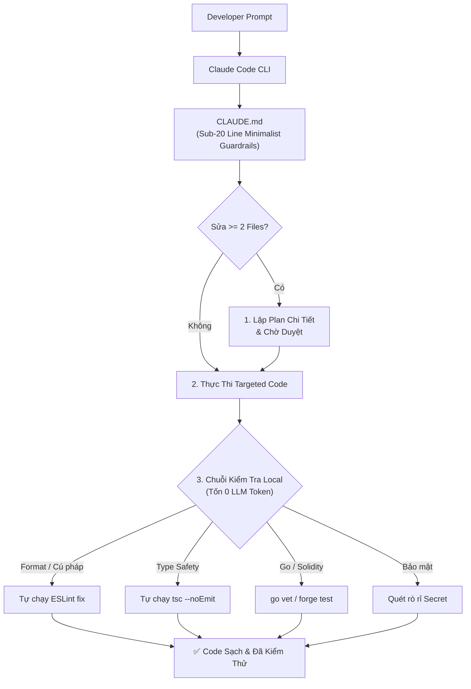

<p align="center">
  <h1 align="center">⚡ claudify-agent</h1>
  <p align="center">
    <strong>Framework tối ưu hóa ngữ cảnh và quy trình làm việc chuẩn doanh nghiệp cho Claude Code, Claude Desktop và các AI Coding Agent tự chủ.</strong>
  </p>
  <p align="center">
    <a href="https://www.npmjs.com/package/claudify-agent"></a>
    <a href="https://www.npmjs.com/package/claudify-agent"></a>
    <a href="https://github.com/mytoandeptrai/claudify-agent/blob/main/LICENSE"></a>
  </p>
  <p align="center">
    <a href="README.md">English</a> | Tiếng Việt
  </p>
</p>

---

## 💡 Tổng Quan

Lấy cảm hứng từ các nghiên cứu thực nghiệm về thất bại của AI Agent khi viết code, **`claudify-agent`** đóng vai trò là "dây cương và hệ điều hành" cho Claude:
- **Chống Tràn Ngữ Cảnh & Hiệu Ứng Tuyết Lăn (Context Snowball):** Triệt tiêu lãng phí token bằng nguyên tắc luật dưới 20 dòng và nạp modular skill theo nhu cầu thông qua cú pháp `@path`.
- **Bắt Buộc Lập Kế Hoạch (Plan-First):** Ép Claude phải xuất ra một kế hoạch (Plan) cụ thể trước khi được phép sửa từ 2 file trở lên.
- **Xác Thực Cục Bộ Tốn 0 Token (Zero-Token Verification):** Đẩy toàn bộ việc sửa format, ESLint, kiểm tra type TypeScript và quét bảo mật cho các script local chạy trên máy tính thay vì đốt hàng trăm ngàn token qua các lượt chat lặp lại của AI.
- **Sẵn Sàng Cho Production Backend & Web3:** Cung cấp sẵn các cẩm nang chuẩn cho hệ thống **Golang** hiệu năng cao, **NestJS** doanh nghiệp, xử lý **Concurrency & Khóa phân tán (Locking)**, và hợp đồng thông minh **Solidity** an toàn.

---

## 📦 Khởi Tạo Nhanh (Quick Start)

Khởi tạo `claudify-agent` vào bất kỳ dự án mới hoặc có sẵn nào chỉ bằng 1 dòng lệnh duy nhất:

```bash
npx claudify-agent init
```

Lệnh này sẽ tự động thiết lập:
- `CLAUDE.md`: File điều phối trung tâm tự động được nạp bởi Claude Code CLI.
- `.claude/rules/`: 13 quy tắc phân tầng kiểm soát quá trình lập plan, thực thi và bảo mật.
- `.claude/skills/`: 12 cẩm nang chuyên sâu theo từng công nghệ (Golang, NestJS, Concurrency, Solidity, Next.js...).
- `.claude/scripts/`: Bộ công cụ tự động kiểm tra code đa ngôn ngữ (`auto-validate.js`, `security-scan.js`).

---

## 🚀 Hướng Dẫn Sử Dụng

### 1. Dùng với Claude Code CLI (Khuyên dùng nhất)
Sau khi chạy `npx claudify-agent init`, mở terminal tại thư mục dự án và gõ:
```bash
claude
```
Claude Code sẽ tự động nhận diện `CLAUDE.md`. Toàn bộ luật bảo vệ, phân tầng ngữ cảnh và chuỗi kiểm tra tự động sẽ chạy ngầm mà không cần cấu hình thêm.

### 2. Dùng với Claude Desktop / Claude Projects
1. Mở **Claude Desktop** $\rightarrow$ Tạo một **Project** trỏ vào thư mục code của bạn.
2. Sao chép toàn bộ nội dung file [`CLAUDE.md`](CLAUDE.md) dán vào ô **Custom Instructions**.
3. Đính kèm thư mục `.claude/` vào Project Files để Claude tra cứu kỹ năng khi cần.

---

## 🧠 Kiến Trúc Hoạt Động (ReAct Loop)



---

## 🛠️ Danh Mục 12 Kỹ Năng Đính Kèm

| Kỹ Năng | Đường Dẫn | Trọng Tâm Giải Quyết |
| :--- | :--- | :--- |
| **Backend Concurrency** | `.claude/skills/backend-concurrency/SKILL.md` | Xử lý Race conditions, Redis Distributed Lock, Deadlocks, Idempotency. |
| **Golang Backend** | `.claude/skills/golang-guide/SKILL.md` | Standard layout (`cmd/`, `internal/`), Worker Pool, Safe Goroutines, Context. |
| **NestJS Enterprise** | `.claude/skills/nestjs-guide/SKILL.md` | Module boundaries, TypeORM Transaction QueryRunner, DTO Validation. |
| **Solidity Smart Contracts** | `.claude/skills/solidity-guide/SKILL.md` | Mô hình CEI, ReentrancyGuard, tối ưu Gas EVM, Foundry/Hardhat tests. |
| **Next.js Guide** | `.claude/skills/nextjs-guide/SKILL.md` | App Router, Server Components (RSC), và Server Actions. |
| **React Guide** | `.claude/skills/react-guide/SKILL.md` | Single Source of Truth, tối ưu Render & Custom Hooks. |
| **Python Guide** | `.claude/skills/python-guide/SKILL.md` | FastAPI, Django, Type hints & Pydantic. |
| **MCP Mastery** | `.claude/skills/mcp-mastery/SKILL.md` | Cấu hình và gọi các Model Context Protocol servers. |
| **Debug Optimizer** | `.claude/skills/debug-optimizer/SKILL.md` | Quy trình truy tìm nguyên nhân gốc rễ (Root Cause) 4 bước. |
| **Tool Selection** | `.claude/skills/tool-selection/SKILL.md` | Chiến lược chọn đúng tool nhằm giảm thiểu số lần gọi API. |
| **Plan Mastery** | `.claude/skills/plan-mode-mastery/SKILL.md` | Lập kế hoạch bài bản trước khi bắt đầu sinh code. |
| **Vite Guide** | `.claude/skills/vite-guide/SKILL.md` | Cấu hình bundling SPA tối ưu hiệu năng. |

---

## 📄 Bản Quyền

Phát hành dưới giấy phép MIT © [jacob-tech](https://github.com/mytoandeptrai)
